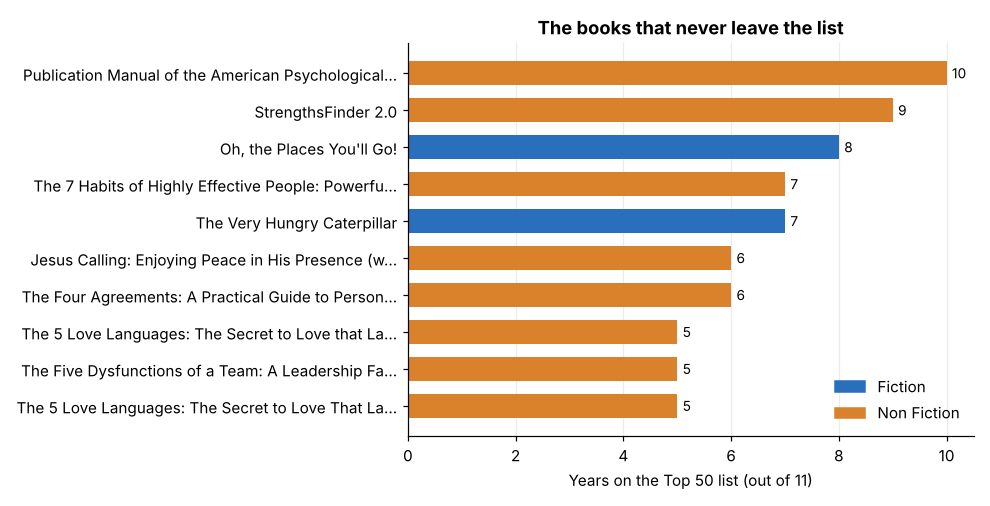
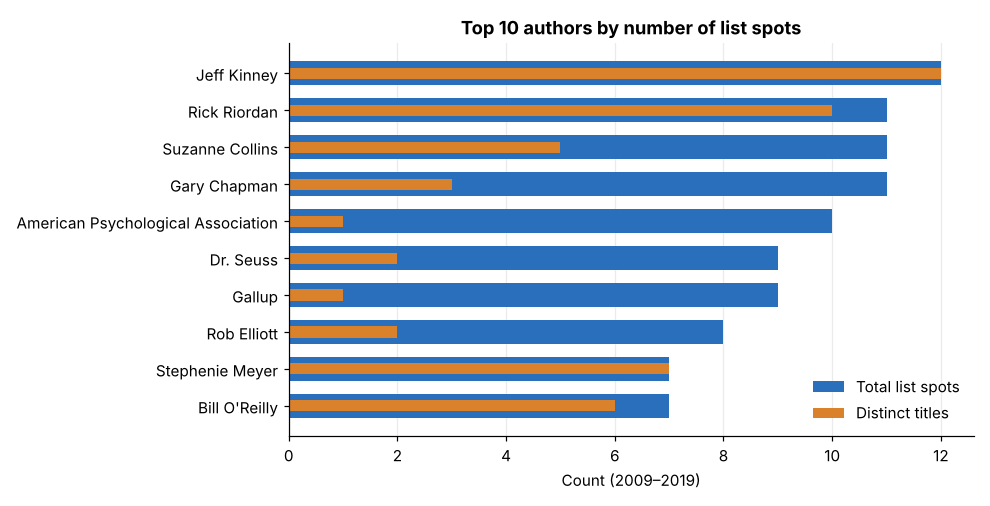
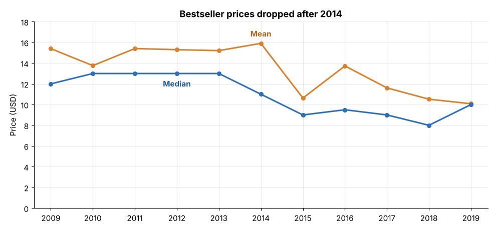
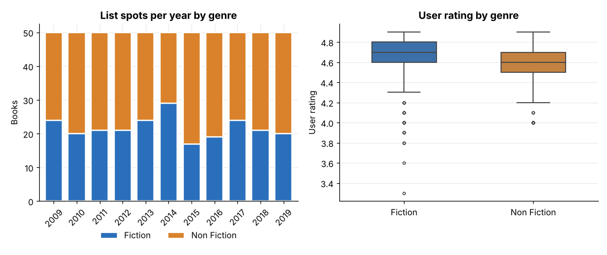
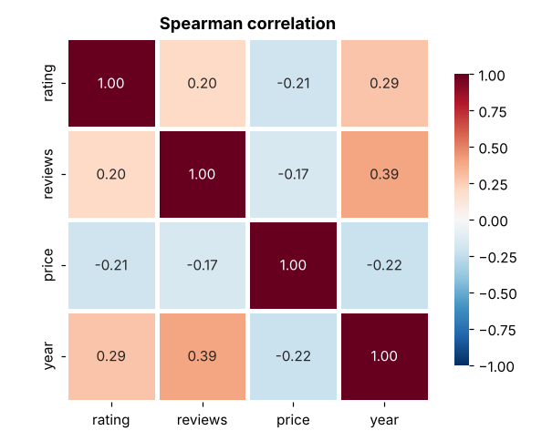

# Amazon Top 50 Bestselling Books (2009–2019): Exploratory Data Analysis

An exploratory analysis of the 550 books that made Amazon's yearly Top 50 list between 2009 and 2019, built with Python, pandas, matplotlib and seaborn.

**Dataset:** [Amazon Top 50 Bestselling Books 2009–2019](https://www.kaggle.com/sootersaalu/amazon-top-50-bestselling-books-2009-2019) (Kaggle, 550 rows × 7 columns: name, author, user rating, reviews, price, year, genre).

## Questions

1. How much of the list is really new books, and how much is the same books returning year after year?
2. Which authors dominate the list?
3. Did bestseller prices change over the decade?
4. Do fiction and non-fiction behave differently?
5. Are rating, reviews, price and year related?

## Key findings

- **The list repeats itself.** 550 list spots come from only 351 distinct titles. 255 titles appear in a single year, while 17 appear in five or more years (the APA *Publication Manual* is on the list in 10 of 11 years).
- **Long tail of authors.** 130 of 248 authors appear only once. Jeff Kinney has the most list spots (12, all different *Diary of a Wimpy Kid* books). Gary Chapman has 11 spots, but they come from essentially one book, *The 5 Love Languages*.
- **Prices fell.** The median price was about $13 in 2010–2013 and $8–$10 in 2015–2019. The mean dropped from $15.91 (2014) to $10.63 (2015).
- **Fiction vs non-fiction.** Non-fiction has more list spots (310 vs 240), but fiction gets more reviews (median 10,922 vs 6,346) and costs less (median $9 vs $12). All 7 list spots rated below 4.0 are fiction.
- **No strong relationships.** All Spearman correlations are weak (|ρ| ≤ 0.39).







## Method notes

- Rows are *book-year* observations, so I count distinct titles when the question is about "books" and rows when it is about "list spots".
- 12 rows have `Price = 0` (free or unavailable listings). They are excluded from price analysis only.
- Spearman correlation is used because reviews and price are heavily skewed.
- The review count is a single snapshot taken when the data was collected, so it is not a time series.

## Limitations

- Only the Top 50 per year, so nothing can be said about books outside the list.
- Titles are matched by exact text, so editions and spelling variants count as separate titles (351 is a slight overcount of truly distinct books).
- Genre is only Fiction / Non Fiction, which is too coarse to say which topics sell.

## Run it

```bash
pip install -r requirements.txt
jupyter notebook analysis.ipynb
```

## Project structure

```
├── analysis.ipynb      # full analysis with outputs and commentary
├── data/bestsellers.csv
├── images/             # charts used in this README
├── requirements.txt
└── README.md
```
